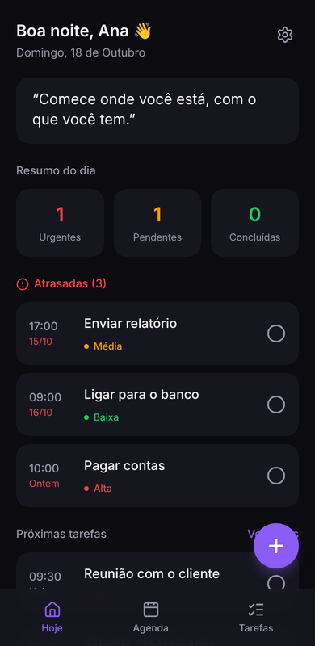
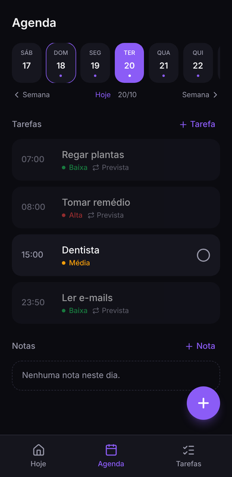
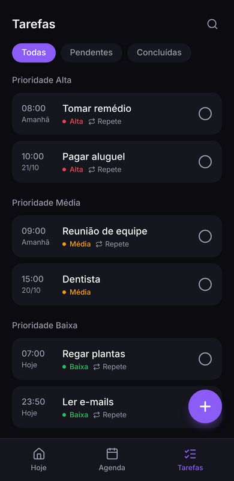

# Minha Agenda

Aplicativo pessoal de **agenda, tarefas e lembretes** para Android — **100% offline**.
Nenhum dado sai do aparelho: não existe servidor, login nem conta.

> 📚 **A documentação completa está neste projeto, na pasta [`docs/`](docs/README.md)** (12 capítulos com prints). Este README é o resumo; os links abaixo levam a cada assunto.

<p>
  
  
  
</p>

| | |
|---|---|
| **Tecnologias** | Next.js 16 (exportação estática) · React 19 · TypeScript · Tailwind CSS 4 · Capacitor 8 · SQLite |
| **Plataforma alvo** | Android 7.0+ (API 24) |
| **ID do app** | `com.mutombo.minhaagenda` |
| **Versão** | 1.5.0 — definida **só** em `package.json` (o Android calcula `versionCode 10500` a partir dela) |

---

## ✨ O que o app faz

| Funcionalidade | Resumo | Detalhes |
|---|---|---|
| **Tela Hoje** | Saudação, frase do dia, resumo, tarefas **atrasadas** e próximas | [Visão geral](docs/01-visao-geral.md#tela-hoje-) |
| **Agenda** | Tarefas e notas de cada dia, navegação por semanas, repetições previstas | [Visão geral](docs/01-visao-geral.md#tela-agenda-agenda) |
| **Tarefas** | Lista por prioridade, filtros, busca, data e atraso em destaque | [Visão geral](docs/01-visao-geral.md#tela-tarefas-tarefas) |
| **Criar e editar tarefa** | Título, descrição, data, hora, prioridade, lembrete | [Visão geral](docs/01-visao-geral.md#tela-nova-tarefa-tarefasnova) |
| **Tarefas que se repetem** | Todo dia, dias úteis, toda semana, todo mês | [Visão geral](docs/01-visao-geral.md#tarefas-que-se-repetem) |
| **Lembretes** | Notificação na hora ou com antecedência (5 min a 1 dia), mesmo com o app fechado | [Notificações](docs/05-notificacoes.md) |
| **Som das notificações** | Padrão do Android, 4 toques próprios ou silencioso; vibração; teste | [Visão geral](docs/01-visao-geral.md#som-das-notificações) |
| **Bloqueio com biometria** | Digital/rosto ao abrir o app, com o PIN do celular como alternativa | [Visão geral](docs/01-visao-geral.md#bloqueio-com-biometria) |
| **Backup em arquivo** | Exportar e restaurar todas as tarefas e notas (sem nuvem) | [Banco de dados](docs/04-banco-de-dados.md#46-backup-em-arquivo-formato) |
| **Confirmação e botão voltar** | Pergunta antes de excluir; o voltar do Android fecha painéis | [Visão geral](docs/01-visao-geral.md#excluir-com-confirmação) |

---

## 🗂️ Onde está cada coisa no projeto

```
minha-agenda/
├── README.md          ← você está aqui (resumo)
├── docs/              ← DOCUMENTAÇÃO COMPLETA (comece por docs/README.md)
│   └── imagens/       ← prints das telas usados na documentação
├── app/               ← telas (Next.js)
├── components/        ← componentes de interface
├── lib/               ← banco, notificações, backup, biometria, utilitários
├── types/             ← tipos TypeScript
├── tests/             ← testes automáticos (npm test)
├── scripts/           ← gerador dos sons de notificação
├── public/            ← arquivos estáticos (motor SQLite do navegador, sons)
└── android/           ← projeto nativo Android (Capacitor)
```

Estrutura detalhada em [Arquitetura](docs/03-arquitetura.md#32-estrutura-de-pastas).

---

## ⚡ Começando em 5 minutos

> Precisa de **Node.js 22 ou mais novo**. Veja todos os requisitos em [Instalação e ambiente](docs/02-instalacao-e-ambiente.md).

```bash
# 1. Instale as dependências
npm install

# 2. Rode no navegador
npm run dev
```

Abra **http://localhost:3000**. Use as ferramentas do navegador em modo celular (F12 → ícone de celular) para ver o app como no Android.

Para gerar o **APK**:

```bash
npm run build            # gera a pasta out/
npx cap sync android     # copia out/ para o projeto Android
npx cap open android     # abre no Android Studio → ▶ Run
```

Detalhes em [Build Android e publicação](docs/08-android-build-e-publicacao.md).

---

## 📚 Documentação completa (pasta `docs/`)

Comece pelo [índice da documentação](docs/README.md). Atalhos:

| # | Documento | Quando ler |
|---|---|---|
| 1 | [Visão geral](docs/01-visao-geral.md) | Primeiro contato: o que o app faz e como cada tela funciona |
| 2 | [Instalação e ambiente](docs/02-instalacao-e-ambiente.md) | Preparar a máquina e rodar o projeto |
| 3 | [Arquitetura](docs/03-arquitetura.md) | Entender como as peças se encaixam |
| 4 | [Banco de dados](docs/04-banco-de-dados.md) | Tabelas, funções de acesso, migrações, formato do backup |
| 5 | [Notificações](docs/05-notificacoes.md) | Lembretes, antecedência, repetição, sons e vibração |
| 6 | [Telas e componentes](docs/06-telas-e-componentes.md) | Referência de cada página e componente |
| 7 | [Design e estilos](docs/07-design-e-estilos.md) | Cores, tokens do Tailwind, padrões visuais |
| 8 | [Build Android e publicação](docs/08-android-build-e-publicacao.md) | Gerar APK/AAB, versão, assinar, publicar, testes no celular |
| 9 | [Guias práticos](docs/09-guias-praticos.md) | Receitas passo a passo para mudanças comuns |
| 10 | [Solução de problemas](docs/10-solucao-de-problemas.md) | Algo deu errado? Comece aqui |
| 11 | [Problemas conhecidos e roadmap](docs/11-problemas-conhecidos-e-roadmap.md) | Limitações atuais e próximos passos |

---

## 🧭 Comandos do dia a dia

| Comando | O que faz |
|---|---|
| `npm run dev` | Servidor de desenvolvimento em `http://localhost:3000` (com recarregamento automático) |
| `npm run build` | Gera o build estático em `out/` (também checa os tipos TypeScript) |
| `npm run lint` | Verifica o código com ESLint (deve terminar sem erros) |
| `npm test` | Roda os testes das regras (repetição, lembretes, backup, sons) |
| `npx next typegen && npx tsc --noEmit` | Checagem de tipos sem gerar build (o `typegen` cria os tipos de rotas que o `tsc` precisa) |
| `npx cap sync android` | Copia `out/` para o Android e atualiza os plugins nativos |
| `npx cap open android` | Abre o projeto Android no Android Studio |

> ⚠️ **Regra de ouro:** toda vez que alterar o código React/Next.js, rode `npm run build` **e** `npx cap sync android` antes de testar no Android. O app Android só enxerga o que está em `out/`.

---

**Filosofia do projeto:** simples, rápido, privado e offline.
