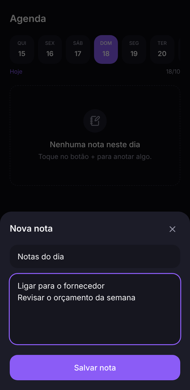
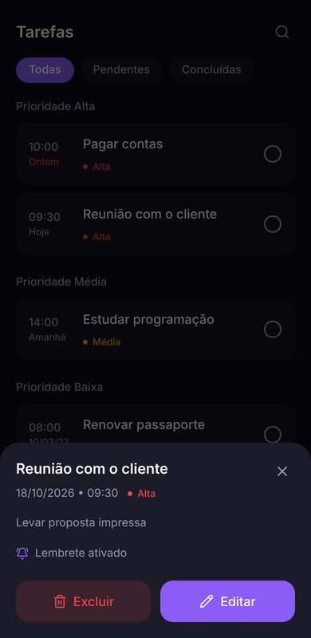
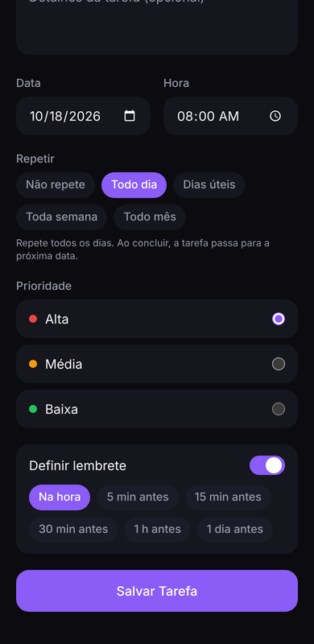
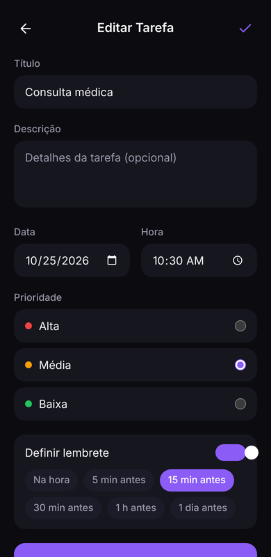
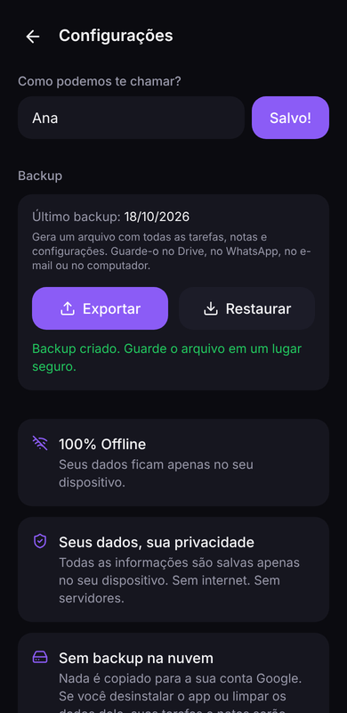
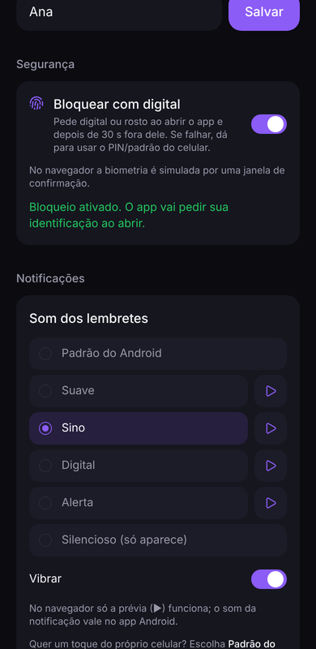
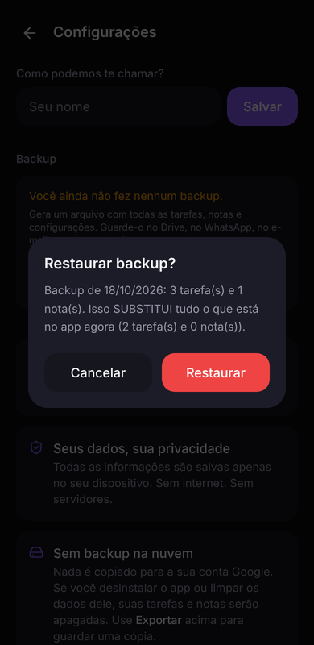
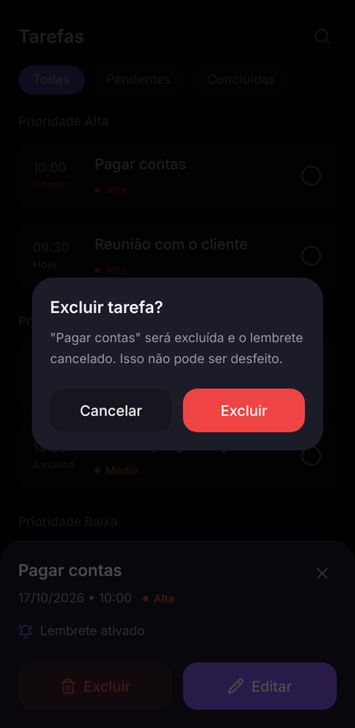
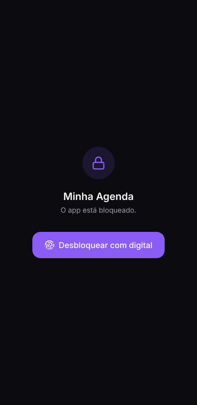

# 1. Visão geral

## O que é o Minha Agenda

Um app Android pessoal para organizar o dia: **tarefas com prioridade e horário**, **lembretes** que tocam no horário certo (mesmo com o app fechado) e **notas por dia**. Tudo fica salvo no próprio celular, em um banco SQLite. O app não usa internet, não tem login e não envia dados a nenhum servidor.

### Público e princípios

- **Uso pessoal, um único usuário por aparelho.** Não há contas nem sincronização.
- **Offline sempre.** Nenhuma tela depende de rede.
- **Simples e rápido.** Poucas telas, poucos toques para registrar algo.
- **Privado.** Os dados ficam só no aparelho. O backup automático do Android está **desligado**, então nada vai para a conta Google. A contrapartida: desinstalar o app ou limpar os dados dele apaga tudo.

## Mapa de telas

```
                ┌────────────── Barra de navegação inferior ──────────────┐
                │                                                         │
         ┌──────▼─────┐            ┌──────────────┐            ┌──────────▼───┐
         │  Hoje  (/) │            │ Agenda       │            │ Tarefas      │
         │            │            │ (/agenda)    │            │ (/tarefas)   │
         └──┬───────┬─┘            └──────┬───────┘            └──┬────────┬──┘
   ⚙️ ícone │       │ botão +             │ +Nota / +Tarefa       │ botão + │ toque no card
            ▼       ▼                     ▼                       ▼         ▼
 ┌────────────────┐ ┌────────────────┐ ┌──────────────────┐            ┌─────────────────┐
 │ Configurações  │ │ Nova Tarefa    │ │ Painel de nota   │            │ Painel detalhe  │
 │ /configuracoes │ │ /tarefas/nova  │ │ (criar/editar)   │            │ da tarefa       │
 └────────────────┘ └────────────────┘ └──────────────────┘            └────────┬────────┘
                                                                                │ botão Editar
                                                                                ▼
                                                                    ┌──────────────────────┐
                                                                    │ Editar Tarefa        │
                                                                    │ /tarefas/editar?id=N │
                                                                    └──────────────────────┘
```

| Rota | Arquivo | Na barra inferior? |
|---|---|---|
| `/` | `app/page.tsx` | Sim — aba **Hoje** |
| `/agenda` | `app/agenda/page.tsx` | Sim — aba **Agenda** |
| `/tarefas` | `app/tarefas/page.tsx` | Sim — aba **Tarefas** |
| `/tarefas/nova` | `app/tarefas/nova/page.tsx` | Não (tem botão Voltar) |
| `/tarefas/editar?id=N` | `app/tarefas/editar/page.tsx` | Não (tem botão Voltar) |
| `/configuracoes` | `app/configuracoes/page.tsx` | Não (tem botão Voltar) |

---

## Tela **Hoje** (`/`)


O "painel" do dia. Ao abrir o app, é esta tela que aparece.

| Elemento | Regra de funcionamento |
|---|---|
| **Saudação** | "Bom dia" antes das 12h, "Boa tarde" das 12h às 17h59, "Boa noite" a partir das 18h. Se o usuário salvou um nome em Configurações, aparece "Boa noite, Ana". |
| **Data** | Formato longo em português: "Domingo, 18 de Outubro". |
| **Frase do dia** | Uma de 8 frases motivacionais. A escolha é fixa para o dia inteiro e muda no dia seguinte (soma ano + mês + dia e pega o resto da divisão por 8). |
| **Resumo do dia** | Conta **somente as tarefas com data de hoje**: **Urgentes** = pendentes com prioridade Alta; **Pendentes** = todas não concluídas; **Concluídas** = marcadas como feitas. |
| **Atrasadas (N)** | Só aparece se houver tarefas **pendentes de dias anteriores**. Título vermelho com a quantidade. Mostra as **3 mais antigas**; se houver mais, aparece o link "+N na lista", que leva à tela Tarefas. Dá para concluir direto pelo círculo do card. |
| **Próximas tarefas** | Até **3** tarefas **pendentes** com data **de hoje em diante**, ordenadas por data e hora. Tarefas de hoje cujo horário já passou também aparecem. Cada card mostra a hora e, embaixo, o dia: "Hoje", "Amanhã", "dd/mm" ou "dd/mm/aa" (outro ano). |
| **Círculo à direita do card** | Marca/desmarca como concluída. Ao concluir, o lembrete é cancelado. |
| **"Ver todas"** | Vai para a tela Tarefas. |
| **Engrenagem ⚙️** | Abre Configurações. |
| **Botão + roxo** | Abre Nova Tarefa. |

---

## Tela **Agenda** (`/agenda`)

 

Tudo o que está marcado para **um dia**: as **tarefas** (com horário) e as **notas** livres.

| Elemento | Regra de funcionamento |
|---|---|
| **Tira de dias** | Mostra 7 dias, com o dia escolhido no centro ao abrir. O dia selecionado fica roxo e hoje tem uma borda roxa. Um **pontinho** embaixo do número indica que o dia tem pelo menos uma tarefa ou nota. |
| **Tocar num dia** | Seleciona o dia e carrega as tarefas e notas dele. |
| **‹ Semana / Semana ›** | Volta ou avança **7 dias**. A tira anda uma semana e o dia central fica selecionado. Não há limite de datas. |
| **"Hoje"** (entre as setas) | Só aparece quando outro dia está selecionado. Volta para hoje. Ao lado aparece a data selecionada (dd/mm). |
| **Seção Tarefas** | Tarefas do dia, por horário. O círculo conclui ou reabre; tocar no card abre o painel de detalhe (Excluir/Editar), igual à tela Tarefas. Sem tarefas, aparece "Nenhuma tarefa neste dia." |
| **Repetições previstas** | Nos dias **futuros**, as tarefas que se repetem aparecem esmaecidas, com "↻ Prevista" e **sem círculo**: só a ocorrência atual pode ser concluída. Tocar abre o detalhe da tarefa real. Os dias com repetições também ganham o pontinho na tira. |
| **+ Tarefa** | Abre Nova Tarefa **já com a data do dia selecionado**. Ao salvar, volta para a Agenda **no mesmo dia**. |
| **Seção Notas** | Notas do dia, na ordem em que foram criadas. O lápis abre o painel de edição. |
| **+ Nota** / **botão + roxo** | Abrem o painel de nova nota, já vinculada ao dia selecionado. |
| **Painel de nota** | Campos *Título* e *Conteúdo*. Se os dois estiverem vazios, "Salvar nota" apenas fecha o painel. Se só o título estiver vazio, a nota é salva com o título **"Nota"**. Em modo edição aparece a lixeira, que **pede confirmação**. Tocar fora do painel **não** fecha (para não perder o texto); o X e o botão voltar do Android fecham sem salvar. |

> 💡 O dia escolhido fica guardado no endereço da tela (`/agenda?date=2026-10-25`). Por isso, ao voltar de Nova/Editar Tarefa, a Agenda continua no mesmo dia.

---

## Tela **Tarefas** (`/tarefas`)

 

Lista completa de tarefas de **todas as datas**.

| Elemento | Regra de funcionamento |
|---|---|
| **Filtros** | *Todas*, *Pendentes* (não concluídas) e *Concluídas*. |
| **Lupa 🔍 / X** | Mostra/esconde a caixa de busca. A busca procura o texto **no título**, sem diferenciar maiúsculas de minúsculas. Fechar a busca (X) **limpa** o texto e a lista volta a mostrar tudo. |
| **Agrupamento** | Seções "Prioridade Alta", "Prioridade Média", "Prioridade Baixa", nessa ordem. Seções vazias não aparecem. Dentro de cada seção: ordem por data e hora. |
| **Círculo do card** | Concluir / reabrir a tarefa. Reabrir uma tarefa com horário no futuro reagenda o lembrete. Numa **tarefa que se repete**, o círculo não marca como concluída: a tarefa **passa para a próxima data** e continua pendente (veja abaixo). |
| **"↻ Repete"** | Aparece no card das tarefas que se repetem. |
| **Data no card** | Embaixo da hora: "Hoje", "Amanhã", "Ontem", "dd/mm" (mesmo ano) ou "dd/mm/aa" (outro ano). Se a tarefa está **pendente** e o dia **já passou**, a data fica **vermelha** (atrasada). |
| **Toque no card** | Abre o **painel de detalhe**: título, data (dd/mm/aaaa), hora, prioridade, descrição (se houver), status do lembrete e os botões **Excluir** (abre a confirmação "Excluir tarefa?"; ao confirmar, exclui e cancela o lembrete) e **Editar**. Fecha pelo X, tocando fora do painel ou com o botão voltar do Android. |
| **Botão +** | Abre Nova Tarefa. |

---

## Tela **Nova Tarefa** (`/tarefas/nova`)



| Campo | Obrigatório | Valor inicial | Observações |
|---|---|---|---|
| Título | **Sim** | vazio | Espaços nas pontas são removidos. |
| Descrição | Não | vazio | Se ficar vazia, é salva como `NULL`. |
| Data | **Sim** | hoje (ou o dia vindo da Agenda) | Seletor nativo de data. |
| Hora | **Sim** | hora atual | Seletor nativo de hora (HH:mm). |
| Repetir | — | **Não repete** | *Não repete*, *Todo dia*, *Dias úteis* (seg–sex), *Toda semana* (no mesmo dia da semana da data) ou *Todo mês* (no mesmo dia do mês). Abaixo aparece uma frase explicando, ex.: "Repete toda sexta-feira." |
| Prioridade | Sim | **Média** | Alta (vermelho), Média (laranja), Baixa (verde). |
| Definir lembrete | — | **ligado** | Liga/desliga a notificação. |
| Quando avisar | — | **Na hora** | Só aparece com o lembrete ligado: *Na hora*, *5 min*, *15 min*, *30 min*, *1 h* ou *1 dia antes*. |

- **Regra do aviso:** a notificação é marcada para *hora da tarefa − antecedência*. Se esse momento já passou mas a tarefa ainda está no futuro (ex.: tarefa daqui a 10 min com "15 min antes"), o aviso toca **na hora da tarefa**, para o usuário não ficar sem lembrete.
- **Salvar:** pelo ✓ no topo ou pelo botão "Salvar Tarefa". Depois de salvar, o app **volta para a tela de onde o formulário foi aberto** (Hoje, Agenda ou Tarefas).
- **Mensagens de erro:** "Dê um título à tarefa antes de salvar.", "Data e hora são obrigatórias." e "Não foi possível salvar a tarefa. Tente novamente." (esta última só aparece se a tarefa **não** foi gravada).
- **Se a tarefa foi salva mas o lembrete falhou** (ex.: notificações bloqueadas), aparece um aviso laranja com o botão **Continuar**. Os botões de salvar somem nesse momento, para não criar a mesma tarefa duas vezes.
- **Voltar (←):** descarta o formulário sem perguntar.

---

## Tela **Editar Tarefa** (`/tarefas/editar?id=N`)



Aberta pelo botão **Editar** no painel de detalhe da tarefa (nas telas Tarefas e Agenda). É o **mesmo formulário** da Nova Tarefa, já preenchido com os dados atuais, e o botão se chama "Salvar alterações".

- Todos os campos podem ser alterados, inclusive **apagar a descrição**, ligar/desligar o lembrete e mudar a antecedência do aviso.
- Ao salvar, volta para a tela de onde veio.
- O status (pendente/concluída) **não muda** ao editar.
- **Lembrete:** ao salvar, o lembrete antigo é cancelado e, se o lembrete estiver ligado, a tarefa pendente e o novo horário no futuro, um novo é agendado para a nova data/hora.
- Mesmas validações, mensagens e aviso de "lembrete não agendado" da Nova Tarefa.
- Se o `id` da URL não existir (ex.: tarefa excluída), a tela volta sozinha para a lista de Tarefas.

---

## Tela **Configurações** (`/configuracoes`)

  

- **"Como podemos te chamar?"**: nome usado na saudação da tela Hoje. Ao salvar, o botão mostra "Salvo!" por 1,5 s. Salvar vazio remove o nome da saudação.
- **Segurança → Bloquear com digital** (ou "com rosto"/"o app", conforme o celular): liga e desliga o bloqueio do app. **Ligar e desligar pedem a biometria**, para ninguém com o celular desbloqueado desativar sem você. Se o celular não tiver digital, rosto nem PIN de tela, o interruptor fica desabilitado e explica o motivo. Veja [Bloqueio com biometria](#bloqueio-com-biometria).
- **Notificações → Som dos lembretes:** *Padrão do Android*, *Suave*, *Sino*, *Digital*, *Alerta* ou *Silencioso (só aparece)*. O botão ▶ toca uma prévia. **Vibrar** liga/desliga a vibração (fica desabilitado no Silencioso). **Enviar notificação de teste** mostra um lembrete de exemplo em 3 segundos, com o som escolhido (só no Android). A troca vale para **todos** os lembretes, inclusive os já agendados. Veja [Som das notificações](#som-das-notificações).
- **Backup** — a única forma de guardar uma cópia dos dados, já que o backup do Android está desligado:
  - **Último backup:** data do último arquivo exportado neste aparelho. Se nunca houve backup, aparece em laranja "Você ainda não fez nenhum backup."
  - **Exportar:** gera o arquivo `minha-agenda-backup-AAAA-MM-DD.json` com todas as tarefas, notas e configurações. No Android abre a janela de **compartilhar** do sistema, onde o usuário escolhe onde guardar (Drive, WhatsApp, e-mail, "Salvar em Arquivos"…). No navegador, o arquivo é baixado.
  - **Restaurar:** escolhe um arquivo de backup. O app confere se o arquivo é válido e mostra a confirmação "Restaurar backup?", com quantas tarefas/notas tem o arquivo e quantas existem agora. Ao confirmar, **tudo o que está no app é substituído** pelo conteúdo do arquivo (não há mistura), e os lembretes das tarefas pendentes são reagendados.
  - O backup **não** leva o bloqueio nem o som escolhido: são configurações de cada aparelho. Assim, restaurar num celular sem digital não tranca ninguém para fora.
  - Arquivos inválidos são recusados com uma mensagem, sem alterar nada: "não é um JSON", "não é um backup do Minha Agenda", "feito por uma versão mais nova do app", "Backup corrompido (tarefa nº 3: hora)".
  - Se algo falhar no meio da restauração, nada é alterado ("Seus dados atuais não foram alterados.").
- Três cartões informativos (apenas texto, no fim da tela): **100% Offline**, **Seus dados, sua privacidade** e **Sem backup na nuvem** (avisa que desinstalar o app apaga tudo e indica o botão Exportar).
- Rodapé com a versão, lida de `package.json`: **"Minha Agenda • v1.5.0"**.

---

## Tarefas que se repetem

| Opção | Repete… | Exemplo (data 23/10/2026, sexta) |
|---|---|---|
| Todo dia | todos os dias | 24/10, 25/10, 26/10… |
| Dias úteis | de segunda a sexta | 26/10 (seg), 27/10… |
| Toda semana | no mesmo dia da semana | 30/10, 06/11… |
| Todo mês | no mesmo dia do mês | 23/11, 23/12… Para o dia 31, nos meses mais curtos cai no último dia (28/29 de fevereiro, 30 de abril…) e volta ao 31 depois. |

**Como funciona:**
- Uma tarefa repetida é **uma tarefa só**, que mostra sempre a **próxima ocorrência**.
- **Concluir** (o círculo) faz a tarefa **pular para a próxima data**, de hoje em diante: uma diária de hoje vai para amanhã; uma diária esquecida há 5 dias vai para hoje (as ocorrências perdidas não se acumulam).
- Enquanto não for concluída, a tarefa repetida aparece em **Atrasadas** como qualquer outra.
- **Para parar de repetir:** Editar → "Não repete". A partir daí, o círculo conclui normalmente.
- **Excluir** apaga a tarefa e todas as próximas repetições (a confirmação avisa isso).
- **Lembretes:** o app agenda os avisos das **próximas 14 ocorrências** de uma vez e renova essa lista toda vez que é aberto. Assim os avisos continuam tocando mesmo que a pessoa não conclua a tarefa por vários dias.
- O detalhe da tarefa mostra a regra, ex.: "Toda semana (sexta)", "Todo mês (dia 31)".

---

## Excluir com confirmação



Excluir uma tarefa ou uma nota sempre abre uma janelinha de confirmação ("Excluir tarefa?" / "Excluir nota?") com **Cancelar** e **Excluir**. Tocar fora dela ou apertar o botão voltar do Android também cancela.

---

## Bloqueio com biometria



Ligado em **Configurações → Segurança**. Com ele ativo:

| Situação | O que acontece |
|---|---|
| Abrir o app | Aparece a tela "O app está bloqueado" e o pedido de digital/rosto abre sozinho. |
| Digital/rosto falhou ou não reconheceu | O próprio Android oferece **usar o PIN/padrão/senha do celular**. Ninguém fica trancado fora dos próprios dados. |
| Cancelou o pedido | Continua bloqueado; o botão **Desbloquear com digital** pede de novo. |
| Saiu do app (outro app, tela apagada) | O conteúdo é **coberto na hora**, para a lista de apps recentes não mostrar tarefas (melhor esforço). |
| Voltou em menos de 30 s | Abre direto, sem pedir de novo (ex.: foi rapidinho no WhatsApp salvar o backup). |
| Voltou depois de 30 s ou mais | Bloqueia de novo e pede a biometria. |
| Botão voltar na tela de bloqueio | Manda o app para segundo plano (não sai do bloqueio). |
| Removeu digital, rosto **e** PIN do celular | Na próxima abertura o app **desliga o bloqueio sozinho**, para não trancar o usuário. |

Celular sem digital/rosto, mas com PIN/padrão: o bloqueio funciona pedindo o PIN/padrão.

---

## Som das notificações

| Opção | Som |
|---|---|
| Padrão do Android | O som de notificação do celular. O usuário pode trocar por **qualquer toque do celular** em *Configurações do Android → Apps → Minha Agenda → Notificações → Lembretes de tarefas → Som*. |
| Suave, Sino, Digital, Alerta | Toques próprios do app (originais, criados para o projeto). |
| Silencioso (só aparece) | A notificação aparece, sem som e sem vibração. |

- **Vibrar:** liga ou desliga a vibração junto com o som.
- A notificação aparece **na parte de cima da tela** (pop-up) quando tem som.
- Trocar o som reagenda os lembretes pendentes no novo som. Os já exibidos não mudam.

---

## Botão voltar do Android

| Situação | O que o botão voltar faz |
|---|---|
| Janela de confirmação aberta | Fecha só a janela (cancela) |
| Painel de detalhe da tarefa ou de nota aberto | Fecha o painel (a nota **não** é salva) |
| Nenhum painel aberto, em tela secundária | Volta para a tela anterior |
| Nenhum painel aberto, na primeira tela | Fecha o app |

---

## Lembretes (notificações)

- Na **primeira abertura**, o app pede permissão para enviar notificações (Android 13+).
- No horário marcado aparece uma notificação: título **"Lembrete de tarefa"**, texto com o título da tarefa e a prioridade.
- Cada tarefa pode avisar **na hora** ou com antecedência (5 min a 1 dia antes). Avisos antecipados dizem quando a tarefa começa: "Começa hoje às 14:00 · Prioridade: Alta".
- O lembrete é **cancelado** quando a tarefa é concluída ou excluída, e **reagendado** quando ela é reaberta, editada ou restaurada de um backup (se o horário estiver no futuro).
- Horários no passado não geram lembrete.

Detalhes técnicos em [05 — Notificações](05-notificacoes.md).

---

## O que o app **não** faz (ainda)

- Categorias, anexos.
- Repetições mais elaboradas ("a cada 2 semanas", "toda terça e quinta", "último dia útil do mês").
- Backup automático na nuvem (por decisão do projeto; existe o backup manual em arquivo).
- Tema claro.
- iOS (o projeto só tem a plataforma Android configurada).

Veja a lista completa e sugestões em [11 — Problemas conhecidos e roadmap](11-problemas-conhecidos-e-roadmap.md).
