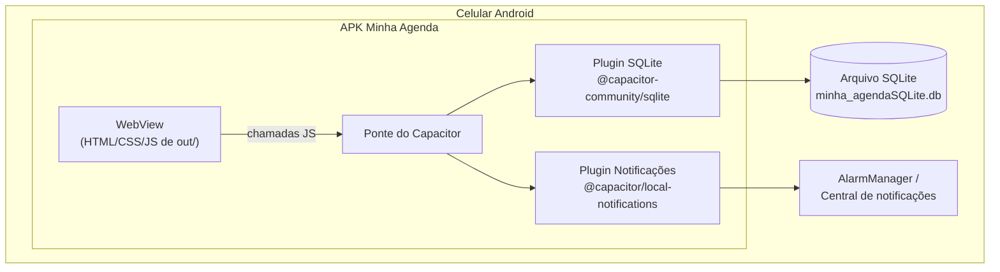
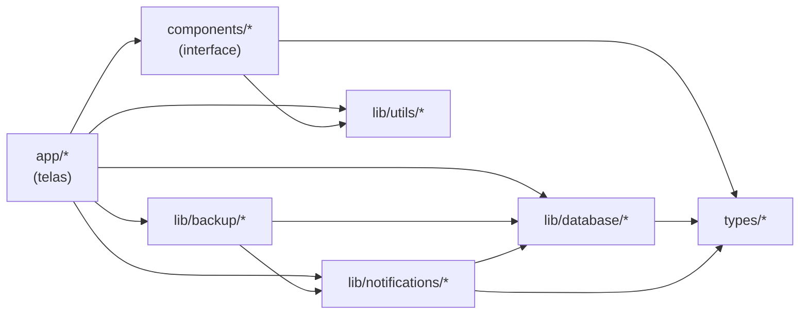
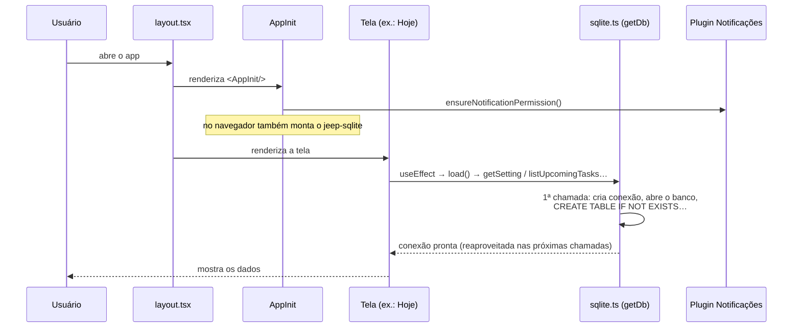
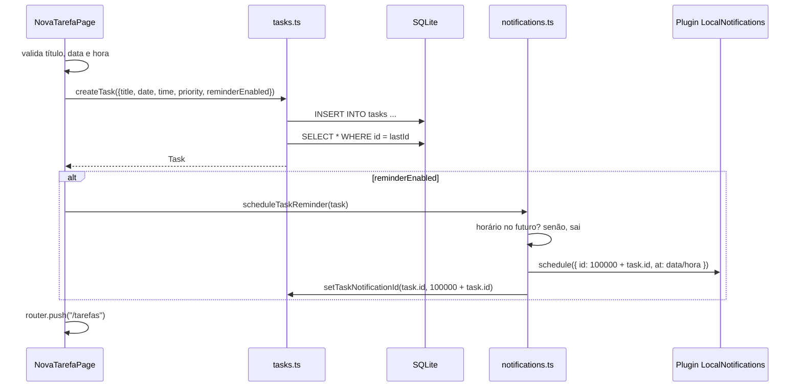

# 3. Arquitetura

## 3.1 A ideia em uma frase

O app é um **site estático feito em Next.js** que o **Capacitor** empacota dentro de um app Android. O JavaScript do site conversa com o celular (banco SQLite e notificações) por meio de **plugins do Capacitor**.



No **navegador** (`npm run dev`) não existe parte nativa. O mesmo código usa o **jeep-sqlite** (SQLite em WebAssembly, salvo no IndexedDB) no lugar do plugin nativo. A escolha é automática, via `Capacitor.getPlatform()`.

## 3.2 Estrutura de pastas

```
minha-agenda/
├── app/                          # Telas (Next.js App Router) — cada pasta com page.tsx vira uma rota
│   ├── layout.tsx                # Esqueleto HTML comum a todas as telas + <AppInit/>
│   ├── globals.css               # Tokens de cor (tema) e estilos globais
│   ├── page.tsx                  # /                → Tela Hoje
│   ├── agenda/page.tsx           # /agenda          → Tela Agenda (notas)
│   ├── tarefas/page.tsx          # /tarefas         → Lista de tarefas
│   ├── tarefas/nova/page.tsx     # /tarefas/nova    → Nova tarefa (usa TaskForm)
│   ├── tarefas/editar/page.tsx   # /tarefas/editar?id=N → Editar tarefa (usa TaskForm)
│   ├── configuracoes/page.tsx    # /configuracoes   → Nome do usuário + informações
│   └── favicon.ico
│
├── components/                   # Peças de interface reutilizáveis (sem acesso ao banco)
│   ├── AppInit.tsx               # Roda 1x ao abrir: permissão de notificação, botão voltar, jeep-sqlite
│   ├── AppLock.tsx               # Envolve o app: tela de bloqueio com biometria
│   ├── BackupSection.tsx         # Bloco "Backup" de Configurações (exportar/restaurar)
│   ├── SecuritySection.tsx       # Bloco "Segurança" de Configurações (liga/desliga o bloqueio)
│   ├── NotificationSoundSection.tsx # Bloco "Notificações" (som, vibração, teste)
│   ├── ConfirmDialog.tsx         # Janela "Tem certeza?" para exclusões
│   ├── JeepSqlite.tsx            # Registra o <jeep-sqlite> (só no navegador)
│   ├── BottomNavigation.tsx      # Barra inferior (Hoje / Agenda / Tarefas)
│   ├── FloatingButton.tsx        # Botão "+" redondo que leva a uma rota
│   ├── TaskForm.tsx              # Formulário de tarefa (compartilhado entre Nova e Editar)
│   ├── TaskCard.tsx              # Card de uma tarefa (hora, dia, título, prioridade, check)
│   ├── TaskDetailSheet.tsx       # Painel inferior com detalhes da tarefa + excluir/editar
│   ├── NoteCard.tsx              # Card de uma nota
│   ├── NoteFormSheet.tsx         # Painel inferior para criar/editar nota
│   ├── PriorityBadge.tsx         # Bolinha colorida + "Alta/Média/Baixa"
│   └── EmptyState.tsx            # Mensagem de "lista vazia"
│
├── lib/                          # Lógica sem interface
│   ├── backup/
│   │   └── backup.ts             # Gerar, validar e restaurar o arquivo de backup (JSON)
│   ├── database/
│   │   ├── sqlite.ts             # Conexão única com o banco + criação das tabelas + migrações
│   │   ├── tasks.ts              # CRUD de tarefas + resumo do dia
│   │   ├── notes.ts              # CRUD de notas
│   │   └── settings.ts           # Chave/valor de configurações
│   ├── security/
│   │   └── appLock.ts            # Biometria: suporte do aparelho, autenticar, ligar/desligar
│   ├── navigation/
│   │   └── backButton.ts         # Botão voltar do Android: pilha de painéis abertos
│   ├── notifications/
│   │   ├── notifications.ts      # Permissão, agendar, cancelar e sincronizar lembretes
│   │   └── sound.ts              # Som/vibração: canais de notificação do Android
│   └── utils/
│       ├── date.ts               # Datas em pt-BR, "hoje", "amanhã", semana, saudação
│       ├── repeat.ts             # Regras das tarefas que se repetem (funções puras)
│       └── quotes.ts             # Frase do dia
│
├── types/                        # Tipos TypeScript compartilhados
│   ├── task.ts                   # Task, Priority, rótulos e ordem de prioridade
│   └── note.ts                   # Note
│
├── tests/                        # Testes das regras (npm test): repeat, reminders, backup, sound
├── scripts/make_sounds.py        # Gera os toques de notificação (Python + numpy)
├── public/                       # Arquivos servidos "como estão" (sql-wasm.wasm, sounds/ para a prévia)
├── android/                      # Projeto Android nativo (gerado pelo Capacitor, com ajustes)
├── capacitor.config.ts           # Configuração do Capacitor (id do app, pasta web, plugins)
├── next.config.ts                # output: "export" → build 100% estático
├── eslint.config.mjs             # Regras de lint
├── postcss.config.mjs            # Liga o Tailwind 4
├── tsconfig.json                 # TypeScript (alias @/ → raiz do projeto)
└── package.json
```

### Pastas geradas (não edite à mão, não versione)

| Pasta | Gerada por | Observação |
|---|---|---|
| `node_modules/` | `npm install` | |
| `.next/` | `npm run dev` / `npm run build` | Cache do Next. Pode apagar sem medo. |
| `out/` | `npm run build` | O app compilado. Vai para dentro do APK. |
| `android/app/src/main/assets/public/` | `npx cap sync` | Cópia de `out/`. **Nunca edite aqui** — será sobrescrito. |
| `android/capacitor-cordova-android-plugins/` | `npx cap sync` | |
| `android/app/build/`, `android/.gradle/` | Gradle | |

## 3.3 Camadas e regras de dependência



Regras que o código segue (mantenha-as):

1. **Só as telas (`app/`) chamam o banco e as notificações.** Componentes recebem dados e *callbacks* por *props* (`onToggle`, `onDelete`, `onSave`…) e não importam `lib/database`.
2. **O banco nunca é acessado direto com SQL fora de `lib/database/`.** As telas chamam funções como `createTask()` e `listNotesByDate()`.
3. **`lib/database` converte linhas do banco para objetos TypeScript.** O banco usa `snake_case` e `0/1` para booleanos; o resto do app só vê `camelCase` e `true/false` (funções `rowToTask` / `rowToNote`).
4. **Notificações dependem do banco, não o contrário.** `notifications.ts` grava o `notification_id` na tarefa; `tasks.ts` não sabe nada sobre notificações. Por isso **a tela** é responsável por chamar as duas coisas em sequência (ex.: excluir = `cancelTaskReminder` + `deleteTask`).
5. **Funcionalidades que juntam banco + notificações ficam num módulo próprio em `lib/`.** Ex.: `lib/backup/backup.ts` lê tudo, valida o arquivo, chama `replaceAllData()` (SQL em `lib/database/replaceAll.ts`) e reagenda os lembretes.
6. **Exceção consciente:** `components/BackupSection.tsx` é um bloco autocontido que chama `lib/backup` e lê o banco diretamente, para não espalhar a lógica de backup pela tela de Configurações. Novos componentes "burros" (cards, botões, painéis) continuam recebendo tudo por *props*.
7. **Imports usam o alias `@/`** (ex.: `import { getDb } from "@/lib/database/sqlite"`), configurado em `tsconfig.json`.

## 3.4 Por que exportação estática? (e o que isso proíbe)

`next.config.ts`:

```ts
const nextConfig: NextConfig = {
  output: "export",           // gera HTML/JS/CSS puros em out/
  images: { unoptimized: true } // otimização de imagens exige servidor
};
```

Dentro do APK **não existe servidor Node**. O Capacitor só sabe abrir arquivos estáticos. Consequências práticas:

| ❌ Não pode usar | ✅ Use em vez disso |
|---|---|
| API Routes (`app/api/...`), Server Actions | Funções em `lib/` chamadas no cliente |
| Buscar dados em Server Components | Componentes com `"use client"` + `useEffect` (todas as telas já são assim) |
| Rotas dinâmicas sem `generateStaticParams` (ex.: `app/tarefas/[id]/page.tsx`) | Parâmetro de busca (`/tarefas/editar?id=5` + `useSearchParams`, como faz a tela Editar Tarefa) ou um *sheet* na mesma tela |
| `next/image` com otimização | `` comum ou `next/image` com `unoptimized` |
| Middleware, cookies, headers, `redirect()` no servidor | `useRouter().push()` no cliente |
| `next start` | `npx serve out` para testar o build no navegador |

> 💡 Ao usar `useSearchParams` em exportação estática, o componente precisa estar dentro de `<Suspense>`, senão o `next build` falha.

## 3.5 Ciclo de vida: o que acontece quando o app abre



Pontos importantes:

- **`getDb()` é preguiçoso e único (singleton).** A primeira chamada inicializa; chamadas simultâneas aguardam a mesma `initPromise`; depois disso todas reutilizam a mesma conexão.
- **As tabelas são criadas a cada abertura com `CREATE TABLE IF NOT EXISTS`**, então um banco novo "se monta sozinho". Isso **não altera tabelas que já existem**; para isso, logo em seguida rodam as **migrações de colunas** (`COLUMN_MIGRATIONS`), explicadas em [04 — Banco de dados](04-banco-de-dados.md#45-migrações-como-mudar-o-esquema-sem-perder-dados).
- Cada tela carrega seus dados no `useEffect` e mantém tudo em `useState`. **Não há estado global** (nem Context, nem Redux). Depois de qualquer alteração, a tela chama `load()` de novo para reler o banco.

## 3.6 Fluxo de exemplo: criar uma tarefa com lembrete



## 3.7 Navegação

- Feita com `next/link` (`<Link href="/agenda">`) e `useRouter()` (`router.push`, `router.back`). Tudo acontece no cliente, sem recarregar a página.
- **Depois de salvar uma tarefa**, o `TaskForm` volta para a tela anterior (`router.back()`); se não houver histórico, vai para `/tarefas`.
- **A Agenda guarda o dia escolhido na URL** (`/agenda?date=AAAA-MM-DD`, via `router.replace`). Assim, ao voltar de Nova/Editar Tarefa, ela reabre no mesmo dia. A Nova Tarefa aceita `?date=` para vir com a data preenchida.
- A **barra inferior** (`BottomNavigation`) é incluída **manualmente** em cada tela principal (Hoje, Agenda, Tarefas). Telas secundárias (Nova Tarefa, Configurações) não a incluem e têm botão "Voltar".
- A aba ativa é calculada pelo caminho: `/` só é ativa no caminho exato; as outras abas usam `startsWith`, então `/tarefas/nova` também destaca "Tarefas" (se a barra for exibida ali).
- **Botão voltar do Android** (`lib/navigation/backButton.ts`, instalado pelo `AppInit`):
  - Cada painel ou diálogo aberto registra sua função de fechar com o hook `useBackHandler(true, onClose)`. Essas funções formam uma **pilha**.
  - Ao apertar voltar, fecha-se **só o item do topo** (ex.: o diálogo de confirmação fecha antes do painel que está embaixo dele).
  - Com a pilha vazia: se há histórico, `window.history.back()`; senão, `App.exitApp()`.
  - Isso é necessário porque, assim que o app escuta o evento `backButton` do plugin `@capacitor/app`, o Capacitor **desliga o comportamento padrão** do botão, e o "voltar de tela / sair" precisa ser refeito em código.
  - No navegador, a tecla **Esc** usa a mesma pilha, o que permite testar sem celular.
  - ⚠️ Todo painel ou diálogo novo deve chamar `useBackHandler`. Senão, o voltar do Android vai **trocar de tela** com o painel ainda aberto.

## 3.8 Layout base

`app/layout.tsx`:

- Define `lang="pt-BR"`, o título "Minha Agenda" e a cor do tema `#0b0b10`.
- Bloqueia zoom (`maximumScale: 1`) para parecer um app nativo.
- Centraliza o conteúdo numa coluna de no máximo **`max-w-md` (448 px)**.
- Renderiza `<AppInit />` uma única vez para todo o app.
- Envolve todas as telas com `<AppLock>`: enquanto o app está bloqueado (ou coberto em segundo plano), o conteúdo fica `inert` (sem foco, sem cliques) e uma camada opaca `z-50` fica por cima.
