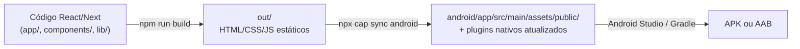

# 8. Build Android e publicação

## 8.1 Como o código vira um APK



| Etapa | Comando | Quando repetir |
|---|---|---|
| 1. Build web | `npm run build` | **Toda** alteração em `app/`, `components/`, `lib/`, `types/`, `public/`, CSS |
| 2. Sincronizar | `npx cap sync android` | Depois de todo build web; depois de instalar/remover plugin do Capacitor; depois de mudar `capacitor.config.ts` |
| 3. Compilar/rodar | ▶ Run no Android Studio | Sempre que quiser testar |

> ⚠️ Esquecer o passo 1 ou o 2 é a causa nº 1 de "mudei o código e nada mudou no celular".

## 8.2 Primeira vez (máquina nova / clone novo)

```bash
npm install
npm run build
npx cap sync android        # obrigatório: recria pastas que não vão para o Git
npx cap open android        # abre o Android Studio
```

No Android Studio:

1. Espere o **Gradle Sync** terminar (barra de progresso no rodapé; na primeira vez pode levar vários minutos).
2. Se aparecer aviso de JDK: *Settings → Build, Execution, Deployment → Build Tools → Gradle → Gradle JDK* → escolha um **JDK 21** (ex.: "jbr-21").
3. Se pedir para instalar o *SDK Platform 36* ou *Build Tools*, aceite.
4. Escolha um emulador ou celular (com **Depuração USB** ligada) e clique em **▶ Run**.

### Atalho sem abrir o Android Studio

Com um celular/emulador conectado:

```bash
npx cap run android            # faz sync, compila e instala
npx cap run android --list     # lista os dispositivos disponíveis
```

## 8.3 Desenvolvimento com *live reload* no celular (opcional)

Para ver mudanças no aparelho sem rebuild a cada alteração:

```bash
# Terminal 1
npm run dev

# Terminal 2 (emulador ou celular via USB)
npx cap run android --live-reload --host localhost --port 3000 --forwardPorts 3000:3000
```

O `--forwardPorts` faz um `adb reverse`, então o aparelho acessa `localhost:3000` do seu computador. Nesse modo o app usa o **SQLite nativo** e as **notificações reais**.

> ⚠️ Quando terminar, rode `npm run build && npx cap sync android` antes de gerar APK. Senão o app pode ficar apontando para o servidor de desenvolvimento.

## 8.4 Gerar APK de teste (debug)

Android Studio → **Build → Build Bundle(s) / APK(s) → Build APK(s)**.

Arquivo gerado: `android/app/build/outputs/apk/debug/app-debug.apk`. Pode ser enviado e instalado em qualquer Android (o usuário precisa permitir "instalar apps de fontes desconhecidas").

Pela linha de comando:

```bash
cd android
./gradlew assembleDebug        # Windows: gradlew.bat assembleDebug
```

## 8.5 Versão do app

A versão é definida **em um lugar só**: o campo `"version"` do `package.json` (hoje `1.5.0`). Todo o resto lê dele:

| Onde aparece | Como chega lá |
|---|---|
| `versionName` do Android (o que o usuário vê na Play Store) | `android/app/build.gradle` lê o `package.json` |
| `versionCode` do Android (número que a Play Store exige que **sempre aumente**) | Calculado: `maior × 10000 + menor × 100 + correção` → 1.5.0 = **10500** |
| Rodapé de Configurações ("Minha Agenda • v1.5.0") | `import { version } from "@/package.json"` |

**Para lançar uma versão nova:**

```bash
npm version patch --no-git-tag-version   # 1.5.0 → 1.5.1  (correção)
npm version minor --no-git-tag-version   # 1.5.0 → 1.6.0  (funcionalidade nova)
npm run build && npx cap sync android
```

Depois gere o build no Android Studio normalmente.

> ⚠️ "Menor" e "correção" precisam ficar abaixo de 100 (ex.: 1.99.99), senão o `versionCode` deixa de crescer de forma correta. Nunca volte a versão para trás depois de publicar.

O trecho de Gradle que faz a leitura foi validado com o Gradle 8 fora do Android Studio: `1.4.0` → `10400` e `2.13.7-beta` → `21307`.

## 8.6 Gerar versão de produção assinada (release)

### 1. Crie a chave de assinatura (uma única vez na vida do app)

```bash
keytool -genkey -v -keystore minha-agenda-release.jks -keyalg RSA -keysize 2048 -validity 10000 -alias minha-agenda
```

> 🔐 **Guarde o arquivo `.jks` e as senhas em local seguro (gerenciador de senhas + backup).** Se perder a chave, não será possível publicar atualizações do app com o mesmo ID. **Nunca** faça commit dela. Acrescente ao `.gitignore`:
> ```
> *.jks
> *.keystore
> keystore.properties
> ```

### 2. Gere o arquivo assinado

**Pelo Android Studio:** *Build → Generate Signed Bundle / APK* → escolha **Android App Bundle** (para a Play Store) ou **APK** (para distribuir direto) → selecione o `.jks` → variante **release**.

**Pela CLI do Capacitor:**

```bash
npm run build && npx cap sync android
npx cap build android \
  --keystorepath ../minha-agenda-release.jks \
  --keystorepass "SENHA" \
  --keystorealias minha-agenda \
  --keystorealiaspass "SENHA" \
  --androidreleasetype AAB      # ou APK
```

Saídas: `android/app/build/outputs/bundle/release/` (AAB) ou `android/app/build/outputs/apk/release/` (APK).

> 💡 O build de release está com `minifyEnabled false` (sem ofuscação/redução de código Java). É o mais seguro com plugins do Capacitor. Se ativar, teste bem o SQLite e as notificações.

## 8.7 Ícone e tela de abertura (splash)

O app ainda usa o **ícone padrão do Capacitor** e o splash padrão.

**Opção A — Android Studio:** botão direito em `app` → *New → Image Asset* → *Launcher Icons (Adaptive and Legacy)* → escolha a imagem (sugestão do projeto: fundo roxo `#8B5CF6` com um "check" branco) → *Next → Finish*. Isso substitui os `mipmap-*/ic_launcher*`.

**Opção B — ferramenta do Capacitor (gera ícone + splash):**

```bash
# coloque assets/icon.png (1024x1024) e assets/splash.png (2732x2732) na raiz do projeto
npx @capacitor/assets generate --android
```

O ícone **da notificação** é outro arquivo (`res/drawable/ic_stat_reminder.xml`) e deve ser branco sobre transparente.

## 8.8 Configuração nativa — onde fica cada coisa

| Arquivo | Conteúdo relevante |
|---|---|
| `capacitor.config.ts` | `appId: com.mutombo.minhaagenda`, `appName`, `webDir: "out"`, cor de fundo, config dos plugins |
| `android/app/build.gradle` | `applicationId`, `versionCode`, `versionName`, tipos de build |
| `android/variables.gradle` | `minSdkVersion 24`, `compileSdkVersion 36`, `targetSdkVersion 36`, versões AndroidX |
| `android/build.gradle` | Android Gradle Plugin **8.13.0** |
| `android/gradle/wrapper/gradle-wrapper.properties` | Gradle **8.14.3** |
| `android/app/src/main/AndroidManifest.xml` | Permissões e atividade principal |
| `android/app/src/main/java/com/mutombo/minhaagenda/MainActivity.java` | Atividade (vazia, herda `BridgeActivity` do Capacitor) |
| `android/app/src/main/res/values/strings.xml` | Nome exibido do app |
| `android/capacitor.settings.gradle`, `android/app/capacitor.build.gradle` | **Gerados** pelo `cap sync` — não edite |

> ⚠️ **Mudar o `appId`/`applicationId`** cria, para o Android, um **app diferente**: os dados do app antigo não são migrados e a Play Store trata como outro produto. Só faça isso antes da primeira publicação.

### Backup automático desligado

`AndroidManifest.xml` tem `android:allowBackup="false"`. Assim o Android **não copia** o banco do app para a conta Google do usuário, de acordo com a promessa "sem servidores". Consequências:

- Desinstalar o app ou "Limpar dados" apaga tarefas e notas de forma definitiva. Configurações avisa isso no cartão **"Sem backup na nuvem"**.
- No Android 12+, a **transferência direta entre aparelhos** (cabo ou Wi-Fi, na configuração de um celular novo) ainda pode copiar os dados, pois `allowBackup="false"` não bloqueia esse caminho. Nada passa por servidor. Para bloquear também isso, seria preciso um arquivo `android:dataExtractionRules` com exclusões.
- Para guardar ou levar os dados a outro celular, o usuário usa o **backup em arquivo** (Configurações → Backup → Exportar/Restaurar). O arquivo é gravado na pasta temporária do app e entregue pela janela de compartilhar do Android. Usa o `cache-path` já declarado em `res/xml/file_paths.xml` e **não exige permissão** de armazenamento.

### Sons de notificação (`res/raw`)

Os toques ficam em `android/app/src/main/res/raw/` (`lembrete_*.wav`). Essa pasta **não** é gerada pelo `cap sync`, então os arquivos são versionados normalmente. Nomes de arquivo em `res/raw` só aceitam letras minúsculas, números e `_`.

### Permissões declaradas

`INTERNET` (padrão do Capacitor; o app não faz requisições, mas a WebView local usa esse mecanismo), `POST_NOTIFICATIONS`, `SCHEDULE_EXACT_ALARM`, `USE_EXACT_ALARM`, `RECEIVE_BOOT_COMPLETED`, `VIBRATE` e `USE_BIOMETRIC` (bloqueio com digital/rosto; também é declarada pela biblioteca `androidx.biometric`, mas fica explícita para quem lê o manifesto). Detalhes em [05 — Notificações](05-notificacoes.md#56-permissões-android).

## 8.9 Checklist para publicar na Google Play

- [ ] `"version"` do `package.json` aumentada (`npm version patch|minor`). O Android calcula `versionName`/`versionCode` sozinho.
- [ ] `npm test`, `npm run lint` e `npm run build` sem erros.
- [ ] `npm run build && npx cap sync android` rodados **logo antes** do build.
- [ ] Gerado **AAB** de **release** assinado.
- [ ] Ícone e splash próprios (não os do Capacitor).
- [ ] Testado em aparelho real: criar/editar/concluir/excluir tarefa, notas, lembrete com app fechado, reinício do aparelho.
- [ ] Play Console: formulário de **Segurança dos dados** (o app não coleta nem compartilha dados) e link para uma **política de privacidade**.
- [ ] Play Console: declaração de uso de **alarmes exatos** (`USE_EXACT_ALARM`), ou remoção dessa permissão.
- [ ] Conferir que `android:allowBackup="false"` continua no `AndroidManifest.xml` (decisão do projeto: nada vai para a nuvem; veja [11 — item 9](11-problemas-conhecidos-e-roadmap.md#9--backup-automático-do-android-estava-ligado)).
- [ ] Testar o **bloqueio**: ligar em Configurações → fechar e abrir o app (pede digital) → errar/cancelar (oferece o PIN) → sair por menos de 30 s (não pede) → sair por mais de 30 s (pede) → ver a lista de apps recentes com o app bloqueado (deve aparecer coberto).
- [ ] Testar os **sons**: escolher cada som → "Enviar notificação de teste" → conferir som e vibração. Escolher "Padrão do Android", trocar o toque nas configurações do Android e conferir.
- [ ] Testar o **botão voltar** do Android: fecha confirmação → fecha painel → volta de tela → sai do app na primeira tela.
- [ ] Testar o **backup no aparelho**: Exportar → salvar no Drive ou em Arquivos → desinstalar → reinstalar → Restaurar o arquivo → conferir tarefas, notas e que os lembretes voltam a tocar.
- [ ] Testar um **aviso antecipado** (ex.: tarefa daqui a 20 min com "15 min antes").
- [ ] Testar uma **tarefa diária com lembrete**: concluir hoje → o aviso de hoje não toca, o de amanhã toca. Confira com `adb shell dumpsys alarm | grep -i minhaagenda` que há vários alarmes agendados.

## 8.10 Atualizando o Capacitor ou plugins

```bash
npm install @capacitor/core@latest @capacitor/cli@latest @capacitor/android@latest
npm install @capacitor/local-notifications@latest @capacitor/app@latest @capacitor/filesystem@latest @capacitor/share@latest @capacitor-community/sqlite@latest
npm install @aparajita/capacitor-biometric-auth@latest
npx cap sync android
```

Atualizações **de versão principal** (ex.: 8 → 9) costumam exigir mudanças em `variables.gradle`, AGP/Gradle e JDK. Siga o guia oficial de migração do Capacitor e teste no aparelho antes de publicar.
